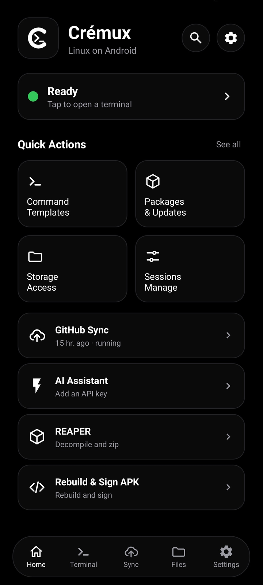
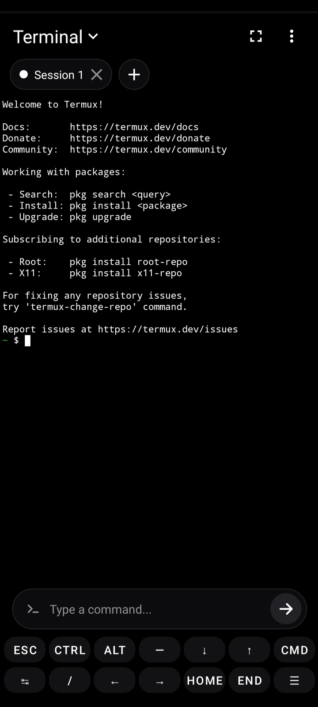
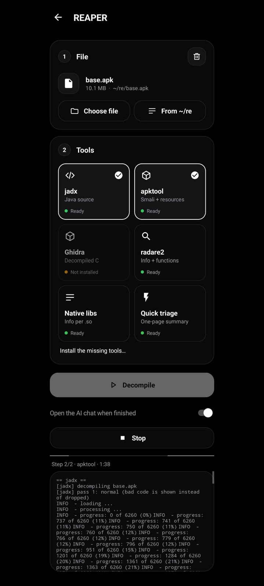
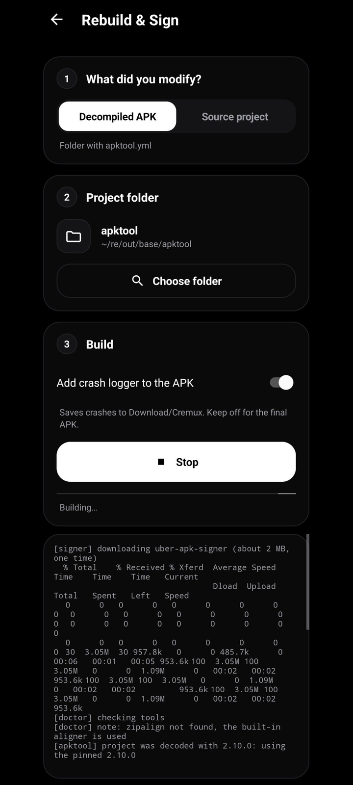
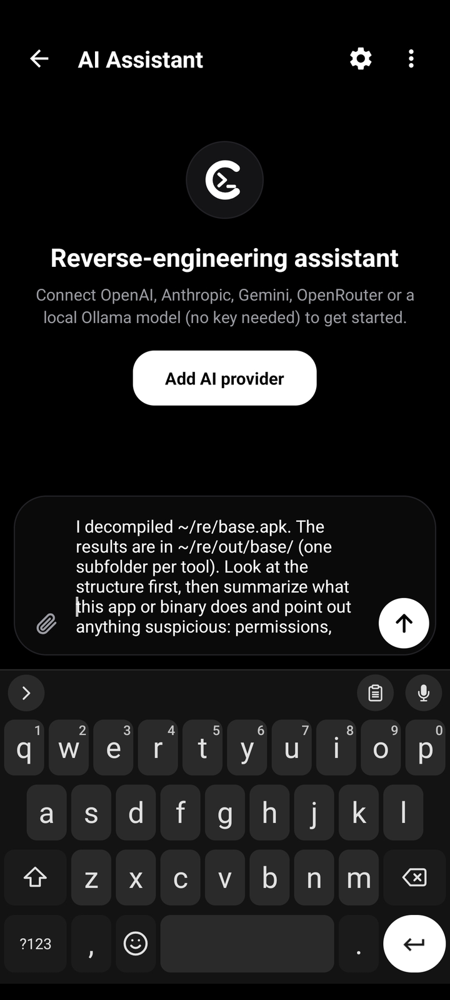
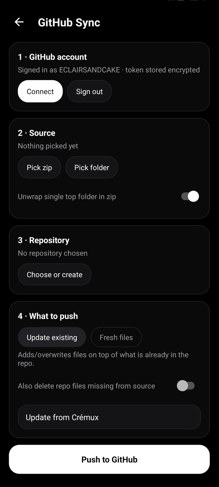

<p align="center">
  
</p>

<h1 align="center">Crémux</h1>

<p align="center">
  <b>Reverse engineer anything in your pocket.</b><br>
  Built on <a href="https://github.com/termux/termux-app">Termux</a>. No PC needed.
</p>

<p align="center">
  
  
  
  
</p>

<p align="center">
  <a href="../../releases">Download</a> ·
  <a href="#features">Features</a> ·
  <a href="docs/AI_ASSISTANT.md">AI &amp; RE guide</a> ·
  <a href="docs/BUILD.md">Build</a>
</p>

## Why Crémux

- **No PC needed.** jadx, apktool, Ghidra and radare2 run inside the app.
- **AI with a leash.** Bring your own key; every command it wants to run needs your tap.
- **Decompile to ship in one app.** Edit, rebuild, re-sign, push, then download the APK from GitHub Actions.

```
APK -> jadx / apktool / Ghidra / radare2 -> AI assist -> edit -> Rebuild & Sign -> GitHub Sync -> APK
```


## Features

- **REAPER decompiler**: jadx, apktool, radare2, Ghidra and native-library triage, with a live log
- **Smart decompiling**: scans the file first (packers, Flutter, React Native, Unity, split bundles) and retries with safer settings on failure
- **AI assistant**: OpenAI, Anthropic, Gemini, OpenRouter, Ollama; every command needs your approval
- **Rebuild & Sign**: rebuild and re-sign an apktool project on the phone
- **GitHub Sync**: push, watch the workflow, see what went wrong, download the APK for your ABI
- **Zip and share**: Deflate-9 zips with split parts that 7-Zip and ZArchiver open
- **Redesigned Termux**: home dashboard, sessions, file manager, packages, command templates, light/dark/AMOLED themes

## Screenshots

<p align="center">
  
  
  
</p>
<p align="center">
  
  
  
</p>

## Download

Get the latest APK from the [Releases](../../releases) page.

- **`Cremux-arm64-v8a.apk`**: for most phones made in the last several years.
- **`Cremux-armeabi-v7a.apk`**: for older 32-bit phones.

<details>
<summary><b>Using it</b></summary>


#### REAPER (no AI, no key needed)
1. **File**: choose a file (it is copied to `~/re/`) or pick one already there.
2. **Tools**: sensible ones are pre-ticked for the file type; missing tools are greyed out and offer to install.
3. **Decompile**: tools run one after another. Output goes to `~/re/out/<name>/<tool>/`.
4. **Zip the result**: choose compression and a part size; optionally copy to `Download/Cremux/`.

See [AI_ASSISTANT.md](docs/AI_ASSISTANT.md) for the tool list, zip limits and the RE toolkit installer.

#### AI assistant
Open it from **Home → AI Assistant**. Supported providers: OpenAI, Anthropic, Gemini, OpenRouter, Ollama (local) and any
OpenAI-compatible server. The model must support tool calling. API keys are encrypted with the Android Keystore and only
sent to the provider you chose. Commands are shown and need your tap; the optional auto-run mode is a best-effort filter,
not a sandbox.

#### GitHub Sync
Sign in with a token, choose or create a repo, push, and follow the workflow run in the app. Failed runs show the
error lines first. **Settings → GitHub → Auto-download workflow files** saves the build for your phone's ABI
(arm64-v8a, or armeabi-v7a on 32-bit devices) when a run passes.


</details>

## FAQ

**Does it need root?** No.

**Which AI providers work?** OpenAI, Anthropic, Gemini, OpenRouter, Ollama and any OpenAI-compatible server. The model must support tool calling.

**Is it safe?** Every AI command needs your tap by default, and keys stay on the device. See [SECURITY.md](SECURITY.md).

**Can I use it with Termux plugins?** Yes. The package name and commands are unchanged.

## Credits

Crémux drives these open-source tools: [jadx](https://github.com/skylot/jadx), [apktool](https://github.com/iBotPeaches/Apktool), [Ghidra](https://github.com/NationalSecurityAgency/ghidra) and [radare2](https://github.com/radareorg/radare2). Thanks to the [Termux](https://github.com/termux/termux-app) project.

## Contributing

See [CONTRIBUTING.md](CONTRIBUTING.md). Release history is in [CHANGELOG.md](CHANGELOG.md).

## Responsible use

For apps you own or have permission to analyze. See [SECURITY.md](SECURITY.md).

## Security

API keys and the GitHub token are stored encrypted with the Android Keystore. Every AI command needs your approval by default. See [docs/BUILD.md](docs/BUILD.md) for signing your own builds.

## Building from source

See [docs/BUILD.md](docs/BUILD.md).

## Notes

- The application id stays `com.termux`, so Crémux cannot be installed next to the official Termux, and Termux commands
  and plugins keep working.
- Crémux is not affiliated with or endorsed by the Termux project. The original project is at
  [termux/termux-app](https://github.com/termux/termux-app).

## License

Based on Termux, licensed under GPLv3 (see [LICENSE.md](LICENSE.md)). Modifications are released under the same license.
